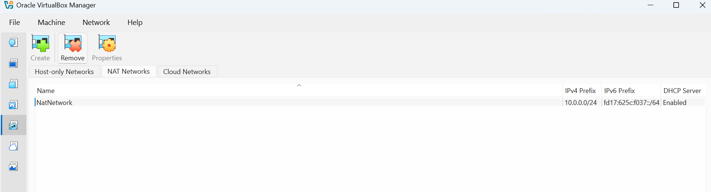
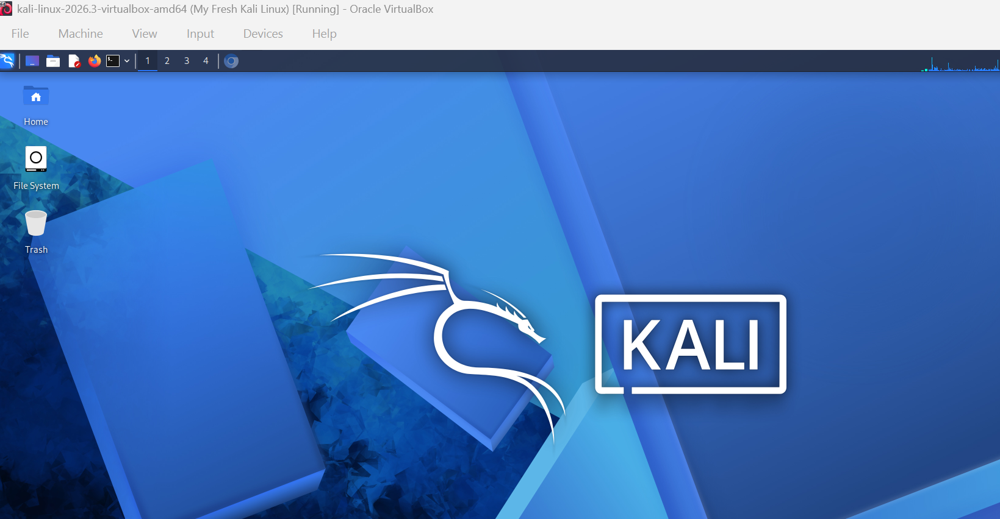
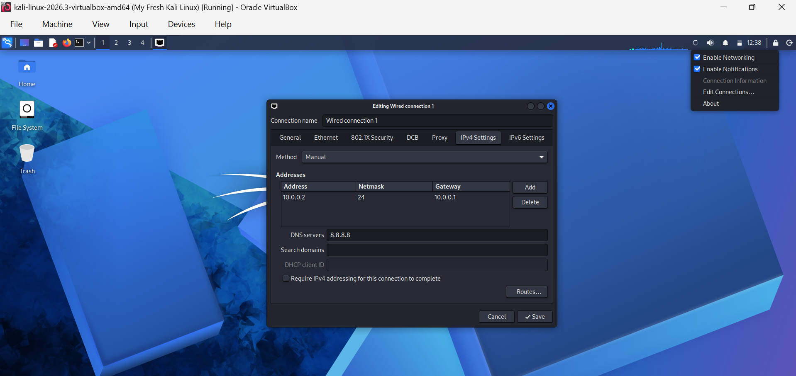
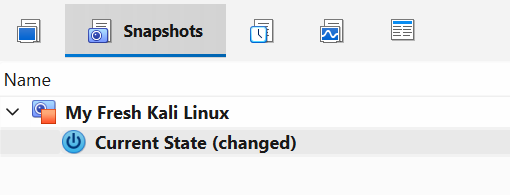

<div align="center">

# 🔐 Cybersecurity Lab Environment Setup

Creating a virtual lab for safe cybersecurity testing and ethical hacking 
</div>

##  Project Overview

This project focuses on setting up a **virtual cybersecurity and penetration-testing laboratory** using VirtualBox and Kali Linux.

---
#  Lab Setup Procedure

## Step 1. Install 7-Zip

7-Zip was installed to extract the Kali Linux virtual-machine package, which may be provided in `.7z` compressed format.

**Tool:** 7-Zip

---

## Step 2. Install VirtualBox

VirtualBox was installed as the hypervisor for managing the virtual machines.

---

## Step 3. Create the NAT Network

A NAT Network was created in VirtualBox.

Configuration:
Network Name: NatNetwork
IPv4 Prefix:  10.0.0.0/24
DHCP:         Enabled
IPv6:         Disabled



A **NAT Network** was chosen because it allows multiple virtual machines connected to the same NAT Network to communicate with each another while maintaining outbound network connectivity.

This will enable future attacker and target virtual machines to communicate with another within the lab.


---

## Step 4. Import Kali Linux

The Kali Linux virtual machine was obtained from the official Kali Linux website and then imported into VirtualBox for configuration.

The VM network adapter was configured as follows:

```text
Adapter 1
Attached to: NAT Network
Network:     NatNetwork
Adapter Type: Intel PRO/1000 MT Desktop
```

The VM was allocated:

```text
RAM: 2048 MB
```

A shared folder was also configured for file transfers between the host operating system and the Kali virtual machine.


---

## Step 5. Configure the Kali Linux Network

The Kali Linux network configuration was reviewed and configured with a consistent IPv4 address.

Example configuration:

```text
IP Address: 10.0.0.2
Subnet Mask: 255.255.255.0
Gateway: 10.0.0.1
DNS: 8.8.8.8
```

Used a fixed IP address makes to make it easier for lab documentation and access the Kali machine in future exercises.



---

## Step 6. Create a Clean VM Snapshot

After completing the initial configuration, a VirtualBox snapshot was created.

Example of snapshot :



---
